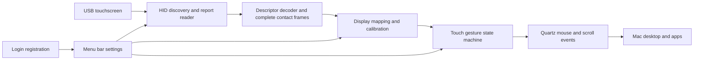

# MacTouch macOS touchscreen research

Research date: 31 October 2026. Target platform: macOS 13 and later.

MacTouch can turn a compatible external touchscreen into a pointing device for ordinary Mac apps by reading its USB HID touch reports, mapping touch coordinates onto a selected display, and posting mouse and scroll events. The practical starting point is a native menu bar app using public macOS APIs. Universal monitor support and complete trackpad equivalence require a substantially larger hardware and compatibility program; neither follows merely from detecting a USB device.

This report separates documented platform behavior from the engineering choices for the first implementation. The app's README and test results describe the delivered features; the later-stage capabilities below are a roadmap, not a claim of implementation.

## The ASUS monitor setup

The intended test setup is an ASUS 22-inch touchscreen connected to a Mac mini through a USB-A to USB-C adapter. The exact monitor model is not yet confirmed. VT229H is a possible model to investigate, not an established device identification.

ASUS lists VT229H among its touch displays and says that native Mac touch is unsupported. Its connection instructions use a USB Type-B cable between monitor and computer for touch, alongside HDMI or D-SUB for video. It also directs users to enable the touchscreen in the monitor's own menu. Those instructions are model-dependent; confirm the model printed on the monitor before applying them. [ASUS touchscreen FAQ, updated 11 September 2026](https://rog.asus.com/us/support/faq/1047313/)

For the proposed bridge, the USB connection must carry data all the way to the Mac. A working video picture proves the display connection, not the touch-data connection. The adapter is not intrinsically a blocker: the next diagnostic is whether macOS enumerates the touchscreen HID interface through it. If not, check the monitor's upstream port, USB cable, adapter, and touch setting before changing driver code. This is an engineering diagnostic sequence; compatibility remains unverified until the actual HID descriptor and reports are captured.

Apple's accessory-approval restriction applies to Mac laptops with Apple silicon. It should not be presented as a default Mac mini troubleshooting step. [Apple accessory approval guidance](https://support.apple.com/en-gb/102282)

## What the reference product establishes

Touch-Base's UPDD is a suite with separate hardware input, desktop interaction, configuration, and application interfaces. Its published coverage includes HID USB, non-HID USB and serial devices, while macOS output includes mouse, pen/tablet and gesture behavior. That is broader than a generic HID reader. [UPDD overview](https://docs.touch-base.com/general)

Its macOS documentation describes device-specific matching through a codeless kernel extension or a system extension, plus a driver, daemon and Commander. Commander handles gesture integration; a Core Graphics mouse interface is also available. This establishes why reproducing the product's entire compatibility range is a driver and device-profile project, not simply a settings window. It does **not** establish that every new HID touchscreen needs a custom driver extension. [UPDD macOS architecture](https://support.touch-base.com/drivers/system-configuration/macos/)

## Recommended architecture

The initial design keeps input parsing and gesture decisions separate from macOS event posting. Tests can feed recorded or synthetic reports into the same parser and state machine without moving the real pointer. Diagnostics should distinguish four states: device discovered, reports arriving, reports understood, and desktop control permitted. A single “connected” indicator cannot explain where the pipeline failed.

Use a per-user process in the logged-in desktop session. A root daemon does not automatically solve permission or desktop-session routing, and this initial input path does not justify adding one. Run the HID callbacks continuously while the settings window is closed; keep Pause and Quit available from the menu bar.

## Reading hardware input

Apple's `IOHIDManager` supports matching devices, receiving attach/remove notifications, and registering input callbacks. Input values are parsed HID elements; report callbacks expose the underlying report boundary. The latter is the better foundation for a descriptor-driven multitouch decoder because it avoids combining a newly received X coordinate with an old Y coordinate. That preference is an engineering choice based on the two API shapes. [IOHIDManager input values](https://developer.apple.com/documentation/iokit/1438367-iohidmanagerregisterinputvalueca), [IOHID report callback](https://developer.apple.com/documentation/iokit/iohidreportcallback)

Use interrupt-driven input-report callbacks rather than repeatedly polling `GetReport`. Apple's documentation specifically directs input-report consumers to the callback API because polling support varies by device. [IOHIDDeviceGetReportWithCallback](https://developer.apple.com/documentation/iokit/1588662-iohiddevicegetreportwithcallback)

Open devices without exclusive access initially. `kIOHIDOptionsTypeSeizeDevice` prevents the system and other clients from receiving the device's events. Exclusive capture may help a tested device that also generates conflicting native mouse events, but must be limited to the selected touch interface and released on Pause or Quit. Do not seize all keyboards, mice, or digitizers. [IOHIDDeviceOpen](https://developer.apple.com/documentation/iokit/1588670-iohiddeviceopen), [exclusive device option](https://developer.apple.com/documentation/kernel/1644502-anonymous/kiohidoptionstypeseizedevice)

CoreHID is Apple's newer Swift API, with device discovery, report descriptors, notifications and virtual devices. `HIDDeviceClient` is available from macOS 15 according to its documentation metadata. Keeping the first backend on IOHID supports the proposed macOS 13 baseline; a separate CoreHID backend is a sensible later migration without rewriting the parser. A virtual HID device is useful for integration tests, but virtualizing a touchscreen alone does not demonstrate that macOS will provide ordinary apps with Windows-style direct touch. [CoreHID](https://developer.apple.com/documentation/corehid), [HIDDeviceClient](https://developer.apple.com/documentation/corehid/hiddeviceclient), [virtual HID devices](https://developer.apple.com/documentation/corehid/creatingvirtualdevices)

## HID decoding and the compatibility boundary

HID descriptors describe fields and their meanings; recognizing a usage does not imply that the operating system implements it. The USB-IF specification explicitly separates usage definition from host support. [USB-IF HID specifications](https://usb.org/hid)

Windows-compatible touchscreens commonly expose Digitizers page `0x0D`, Touch Screen usage `0x04`. Each contact includes Tip Switch `0x42`, Contact Identifier `0x51`, and Generic Desktop X/Y `0x30`/`0x31`; Contact Count is `0x54`. Contacts may include confidence, pressure, width and height. Contact count includes reported contacts even when their tip switches indicate lift, so it is not simply the number of fingers currently down. [Microsoft touchscreen HID requirements](https://learn.microsoft.com/en-us/windows-hardware/design/component-guidelines/touchscreen-required-hid-top-level-collections)

The decoder must preserve contact identity for a contact's lifetime and interpret optional confidence correctly. USB-IF defines touch-valid/confidence true as an intended valid touch. Scan Time, when provided, is shared by contacts in the same frame. [USB-IF HID usage tables, digitizer usages](https://usb.org/sites/default/files/hut1_21_0.pdf)

Standard serial reporting describes one contact per packet, with a Contact Identifier and no Contact Count. Treating each packet as the complete set of fingers loses earlier held contacts. MacTouch 0.1.1 fixes this by retaining per-device contacts by identifier until an explicit lift/confidence release, with reset on stream interruption and a 32-contact cap. A synthetic regression reproduces the one-point symptom and verifies the two-finger scrolling pipeline; this does not establish that the user's ASUS descriptor uses serial reporting. [Microsoft packet reporting modes](https://learn.microsoft.com/en-us/windows-hardware/design/component-guidelines/selecting-packet-reporting-modes-in-multitouch-drivers)

Parallel reports contain a frame's contact records in one packet. Hybrid devices spread a frame across several reports: the first carries the total contact count and later packets carry a count of zero. Therefore, “zero count means release all fingers” is wrong for a general hybrid decoder. MacTouch now includes a bounded per-device assembler, informed by Touch-Up's MIT implementation: matching scan times and contact IDs are required, with a 32-contact ceiling and 50 ms deadline. Partial frames never reach the pointer engine. A common-run-loop timer also cancels an incomplete frame if its remaining packets never arrive. Ambiguous layouts and hybrid reports without scan times remain unsupported. [Microsoft packet reporting modes](https://learn.microsoft.com/en-us/windows-hardware/design/component-guidelines/selecting-packet-reporting-modes-in-multitouch-devices), [Touch-Up source](https://github.com/shueber/Touch-Up/blob/59a4fd28ae939dafb2f4ad9df9b00e959b40eada/TouchUpCore/HIDInterpreter.c)

Further implementation requirements are engineering constraints for reliable parsing:

- Read field bit widths, offsets, signed logical ranges, report IDs, padding, and nested collections from the descriptor. Do not assume every monitor uses 16-bit X/Y fields at fixed offsets.
- Bound all allocations and field reads; reject truncated reports, inconsistent descriptors, unsupported array encodings, and coordinates with an unusable logical range.
- Associate X, Y and Tip with the same finger collection. Do not mix pen and finger collections or treat a touchpad as a screen merely because both are digitizers.
- Keep contact state per physical device and per frame. Never combine two monitors' contacts into one gesture.
- Cancel output on disconnect, permission loss, unsupported input, or a lost selected display. A stale contact must not leave a synthetic mouse button held down.

## Desktop interaction and gesture limits

Quartz exposes public constructors for mouse and scroll-wheel events, and `CGEvent.post` inserts events into the system stream. Mouse-event positions use global coordinates. These APIs support the initial pointer, click, drag, secondary-click and scrolling approach. [Quartz mouse events](https://developer.apple.com/documentation/coregraphics/cgevent/init(mouseeventsource:mousetype:mousecursorposition:mousebutton:)), [Quartz event posting](https://developer.apple.com/documentation/coregraphics/cgevent/post(tap:)), [Quartz scroll events](https://developer.apple.com/documentation/coregraphics/cgevent/init(scrollwheelevent2source:units:wheelcount:wheel1:wheel2:wheel3:))

AppKit can receive trackpad touches and gesture events such as magnify, rotate and swipe. Its documented receiving interface is not a promise of an equivalent public constructor for arbitrary system-wide touch injection. `NSEvent.EventType.directTouch` specifically describes the Touch Bar, not a general external touchscreen. [Apple trackpad event guide](https://developer.apple.com/library/archive/documentation/Cocoa/Conceptual/EventOverview/HandlingTouchEvents/HandlingTouchEvents.html), [NSEvent gesture types](https://developer.apple.com/documentation/appkit/nsevent/eventtype/gesture)

Consequently, the first product should promise **touch-to-mouse and touch-to-scroll translation**. Pinch zoom, rotation, pressure-sensitive drawing, Mission Control gestures and direct multi-finger input inside arbitrary third-party apps need separate development and validation. Keyboard shortcuts can implement some app-specific actions, but they are not equivalent to native gesture streams. Avoid undocumented event numbers and private multitouch frameworks as the default shipping design. A later application SDK or local touch protocol could deliver full contact frames to cooperating apps.

Gesture design also requires deliberate tradeoffs. Immediate mouse-down gives responsive dragging, while waiting briefly can distinguish a tap from a two-finger gesture. A transition to two fingers must release any existing synthetic drag before scrolling. Long-press secondary click must not also produce an unintended primary click. Tests should assert the exact output sequence, including cancellation and finger-identity changes.

## Display mapping

`CGDisplayBounds` uses global display coordinates relative to the upper-left of the main display. Other displays can have negative origins. Map normalized HID coordinates into those bounds; do not multiply by Retina backing scale or use an AppKit bottom-left frame without conversion. [CGDisplayBounds](https://developer.apple.com/documentation/coregraphics/cgdisplaybounds(_:))

Explicitly choose a destination display because USB touch-interface identity and video-display identity do not necessarily provide a portable automatic pairing. Store a stable display identity and device profile, provide rotation and axis correction, and stop injection if the saved display disappears. Recompute mapping when display layout changes. For a future calibration wizard, use three or more well-separated targets to solve an affine transform, reject degenerate samples, and verify the remaining corners. These are design recommendations rather than platform guarantees.

## Permissions and distribution

Accessibility approval and HID input access must be diagnosed separately. `AXIsProcessTrustedWithOptions` reports trust, and its prompt is asynchronous; asking for permission does not grant it. The UI should refresh status after the user returns from System Settings. [Accessibility trust check](https://developer.apple.com/documentation/applicationservices/1459186-axisprocesstrustedwithoptions)

The IOKit APIs include `IOHIDCheckAccess` and `IOHIDRequestAccess`. Apple notes that access to certain HID classes requires approval; the requirement is device-class dependent. Detect the actual open/read result and show Input Monitoring guidance when relevant rather than assuming that enumeration proves readable input. [IOHIDCheckAccess](https://developer.apple.com/documentation/iokit/3181573-iohidcheckaccess), [IOHIDRequestAccess](https://developer.apple.com/documentation/iokit/3181574-iohidrequestaccess), [Apple HID access guidance](https://developer.apple.com/documentation/CoreHID/CommunicatingWithHIDDevices)

Direct distribution is the proposed initial route. Apple lists accessibility-assistive capabilities among App Sandbox restrictions, while Mac App Store apps require the sandbox. This design choice is not a prediction of App Review acceptance or rejection. [Apple sandbox restrictions](https://developer.apple.com/documentation/security/protecting-user-data-with-app-sandbox)

For customer distribution, use a stable bundle identity, Developer ID signing, Hardened Runtime, a secure timestamp, notarization and a stapled ticket. An ad-hoc local build is useful for development but is not a finished trusted installer. Test the signed distribution on a clean Mac; changing development signatures or paths can make permission troubleshooting misleading. [Apple notarization requirements](https://developer.apple.com/documentation/security/notarizing-macos-software-before-distribution), [distribution testing](https://developer.apple.com/documentation/xcode/packaging-mac-software-for-distribution)

## Background operation and automatic startup

For macOS 13+, use `SMAppService.mainApp` to register the menu bar app as a login item, expose its real registration state, and link to Login Items settings when user approval is needed. Registering the main app causes it to launch at subsequent logins. This is **start at user login**, not pre-login touchscreen support, FileVault unlock support, or a boot-time driver. [SMAppService](https://developer.apple.com/documentation/servicemanagement/smappservice), [registration behavior](https://developer.apple.com/documentation/servicemanagement/smappservice/register())

Do not describe main-app login registration as crash supervision. Apple documents automatic crash/nonzero-exit restart for LoginItem helper bundles separately. If supervised recovery becomes a requirement, place the input service in a registered login helper or LaunchAgent and test intentional Quit, crash restart and user-disabled state independently. [SMAppService registration semantics](https://developer.apple.com/documentation/servicemanagement/smappservice/register())

The menu bar must keep the background activity visible and controllable. Pause should release contacts, and Quit should end the process. Handle sleep/wake, device reconnect, display removal and session changes; avoid polling rapidly when no device is present. Apple recommends visible controls and user-managed Service Management registration for persistent work. [Apple background-process guidance](https://developer.apple.com/documentation/appkit/managing-ongoing-background-processes-in-your-mac)

## When a driver extension becomes necessary

Escalate to a device-specific adapter only after diagnostics show why the standard HID path fails. Examples include vendor-specific initialization, non-HID USB protocols, an interface owned incompatibly by another driver, and firmware that reports an unusual format. Some cases can be solved with a user-space profile; others need DriverKit. USBDriverKit is Apple's framework for custom or non-class-compliant USB devices and is installed through System Extensions. [USBDriverKit](https://developer.apple.com/documentation/usbdriverkit)

A distributable DriverKit extension needs appropriate Apple-granted entitlements, device/vendor information, provisioning and signing; the containing app needs system-extension activation capability. These are real external dependencies for a broad hardware product. Do not ship a workflow requiring customers to disable SIP or lower startup security as the baseline. [Apple DriverKit entitlement requirements](https://developer.apple.com/documentation/driverkit/requesting-entitlements-for-driverkit-development)

## Hardware acceptance plan

The following are proposed release gates, not completed hardware results:

| Area | Acceptance evidence |
| --- | --- |
| ASUS identification | Exact model, touch controller vendor/product IDs, transport, descriptor and supported report mode recorded |
| Connection | Touch interface discovered through the intended cable and adapter; reports arrive with the settings window closed |
| Coordinates | Corners and center align on the intended display; repeat with secondary displays above/left, rotation and scaling |
| Input | Repeated tap, double-click, drag, secondary-click and scrolling sequences show no extra clicks or stuck buttons |
| Recovery | Unplug while dragging, reconnect, sleep/wake and display disconnect all release output and recover predictably |
| Permissions | Denied, granted and revoked permissions produce accurate status and no hidden retries that interfere with the desktop |
| Startup | Signed app starts after login when enabled, stays off when disabled, and does not reopen its settings window every login |
| Performance | Measure report-to-post latency, idle CPU and memory on the actual monitor; set numeric targets from those measurements |
| Distribution | Signed/notarized artifact tested on a clean supported Mac, including uninstall and login-item removal |

The immediate next hardware step is to make the ASUS touch interface enumerate and inspect its descriptor. If it uses supported parallel or guarded hybrid reports, the user-space bridge can be validated directly. Otherwise the next deliverable is a device profile backed by captured reports and regression fixtures, followed by another hardware test. No model belongs on a confirmed compatibility list until that end-to-end test passes.
